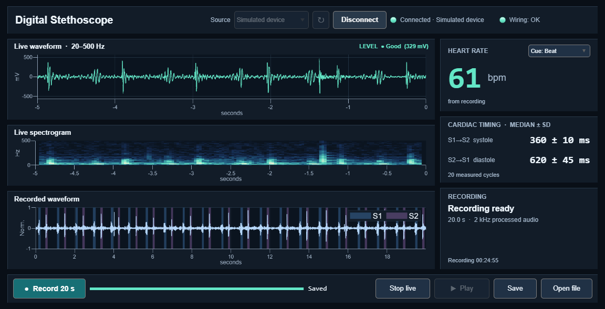

# Heart Sound Monitor: ESP32 + MATLAB Digital Stethoscope

   

A low-cost **digital stethoscope**. A microphone in the tube of an ordinary stethoscope feeds an ESP32, which streams the heart sound over USB to a **MATLAB dashboard**. You see the heartbeat live, hear a soft chime on every detected beat, measure heart rate and the timing between the two heart sounds, and record, replay and export your recordings.



This version is a **measurement and visualisation tool**. It does **not** classify heart sounds as normal or abnormal. For a version with a machine-learning screening result, see [digital-stethoscope-esp32-matlab](https://github.com/M-Umar-khawaja/digital-stethoscope-esp32-matlab).

> **Not a medical device.** Educational and research project. It does not diagnose anything.

## Features

- **Live heart sound**, filtered 20-500 Hz with the 50 Hz mains hum removed, and a **live spectrogram**
- **Real-time heart rate** (from the last 8 seconds)
- **Heartbeat sound cue**: a soft chime on every detected beat. Choose **Beat**, **Lub-dub** (a second, higher note for the second heart sound) or **Off**
- **Level meter** (Good / Too weak / Too loud) and an automatic **wiring check**, so you can place the chest piece and set the gain before recording
- **20-second recording** with **S1 and S2 marked**, heart rate, **systole and diastole timing** (median ± SD) and the number of measured cycles
- **Recording quality check**: tells you when a recording is too short or the signal is poor, and why
- **Automatic export** of every recording: raw WAV, filtered WAV, measurements (MAT), waveform picture (PNG), dashboard screenshot (PNG) and a **replay video (MP4)** of the scrolling waveform and spectrogram
- **Replay**: stop the live view and press Play to watch the recorded waveform and spectrogram scroll in sync with the sound
- **Open file**: analyse any WAV recording sampled at 2 kHz or higher
- **"Simulated device" mode**: try everything without hardware, using a real heart recording
- **No MATLAB toolboxes needed**: filters and the S1/S2 detection are implemented in this repository

## Quick start (no hardware needed)

1. Install **MATLAB R2024b**. Base MATLAB is enough.
2. Keep the project folder together. Open `START.m` in MATLAB and click **Run**.
3. Under **Source** choose **Simulated device** and click **Connect**. The heartbeat chime starts after a short warm-up.
4. Click **Record 20 s** and wait. The measurements appear on the right, and the recording is saved automatically to `software/recordings/`. Wait for **Saved** before closing the window.
5. Click **Stop live**, then **Play** to replay the recording. **Resume live** returns to the live view.

## Use the real stethoscope

1. Build the hardware (see below) and plug in the ESP32 with a USB **data** cable. Close Arduino Serial Monitor.
2. In the dashboard click the refresh button, choose the COM port, and click **Connect**. The wiring indicator should say **OK**.
3. Select the diaphragm side of the chest piece. Press it firmly on bare skin in a quiet room and keep your hand still.
4. Wait until the level meter says **Good** and a heart rate appears, then click **Record 20 s**.

If the level says *Too loud*, hold still or turn the small gain screw on the microphone board a little. If it says *Too weak*, press the chest piece more firmly.

## Hardware

| Part | Notes |
|---|---|
| Stethoscope chest piece + tube | The microphone sits at the end of the tube, sealed against it |
| GY-MAX4466 microphone module | Powered from **3V3** (not 5V); gain trimmer on the back |
| ESP32-WROOM-32 dev board | Input on GPIO34 (ADC1_CH6), 12-bit, 4 kHz, 921600 baud |
| 1 kOhm resistor + 100 nF capacitor | Low-pass filter in front of the ADC |
| USB data cable | Carries power and data |

The build sheet has the circuit, exact breadboard holes, a parts list and a first-power test: [`docs/Circuit_and_Wiring_Build_Sheet.pdf`](docs/Circuit_and_Wiring_Build_Sheet.pdf) (also as [HTML](docs/Circuit_and_Wiring_Build_Sheet.html)). System overview: [`docs/Block_Diagram.pdf`](docs/Block_Diagram.pdf).

**Firmware:** open `firmware/stethoscope_esp32/stethoscope_esp32.ino` in Arduino IDE, choose **ESP32 Dev Module** and upload. The sketch header lists the wiring and serial settings, and it checks the wiring by itself on power-up.

## How it works

```
heart sound -> stethoscope tube -> MAX4466 microphone -> RC low-pass filter
   -> ESP32 ADC (12 bit, 4 kHz) -> USB serial (921600 baud) -> MATLAB
   -> notch filters + 20-500 Hz band-pass -> live waveform, spectrogram, level, heart rate
   -> heartbeat detector -> chime
   -> recording -> S1/S2 segmentation (HSMM) -> heart rate and timing -> export
```

| Part | Method |
|---|---|
| Filtering | Butterworth band-pass 20-500 Hz and 50/100/150/200/250 Hz notches (zero-phase for recordings, causal for the live view) |
| S1 / S2 detection | Logistic-regression HSMM (Springer et al.) on 4 envelope features |
| Heart rate | Autocorrelation of the homomorphic envelope |
| Heartbeat chime | 25-150 Hz envelope, adaptive threshold, refractory period; chime at 659 Hz (S1) and 988 Hz (S2), far outside the detection band |

## Accuracy of the S1/S2 detection

Measured on 236 hand-annotated recordings from public datasets that were not used for fitting (60 ms tolerance): **F1 91.6%**, heart rate **mean error 4.1 bpm**, within 5 bpm on 91% of recordings. These numbers describe the detection method on clean public recordings. On the real ESP32 microphone, results depend on contact, noise and gain.

## Repository layout

```
START.m                      open in MATLAB and press Run
software/                    dashboard (StethoscopeApp.m) and launcher
software/core/               signal processing, live acquisition, heartbeat chime, measurements
software/assets/             S1/S2 and signal-quality parameters, one demo WAV
firmware/                    ESP32 Arduino sketch
docs/                        build sheet, block diagram, screenshot
software/recordings/         created on first export (not stored in this repository)
```

## Notes

- Tested on Windows with MATLAB R2024b. The ESP32 may need the CH340 USB driver the first time.
- The MP4 is rendered in a background MATLAB process (about a minute). Installing [FFmpeg](https://ffmpeg.org) (`winget install --id Gyan.FFmpeg --exact`) adds the heart sound to the video; without it the video and the filtered WAV are saved separately.
- Only one program can use the COM port at a time.

## Datasets, credits and references

The demo recording is record `a0001` from the [PhysioNet/CinC Challenge 2016 database](https://physionet.org/content/challenge-2016/1.0.0/), used under the [Open Data Commons Attribution License v1.0](https://physionet.org/content/challenge-2016/view-license/1.0.0/). The S1/S2 parameters were fitted on annotated recordings from the PhysioNet/CinC 2016 and [CirCor DigiScope](https://physionet.org/content/circor-heart-sound/) datasets.

- Clifford et al., *Classification of normal/abnormal heart sound recordings: the PhysioNet/Computing in Cardiology Challenge 2016*, Computing in Cardiology 2016.
- Oliveira et al., *The CirCor DigiScope Dataset: From Murmur Detection to Murmur Classification*, IEEE JBHI 2022.
- Springer, Tarassenko, Clifford, *Logistic Regression-HSMM-Based Heart Sound Segmentation*, IEEE Transactions on Biomedical Engineering 2016.
- Goldberger et al., *PhysioBank, PhysioToolkit, and PhysioNet*, Circulation 2000.

## License

MIT, see [`LICENSE`](LICENSE). The public datasets keep their own licences.

---

*Built as a final-year project in Biomedical Engineering Technology. Questions and ideas are welcome via Issues.*
